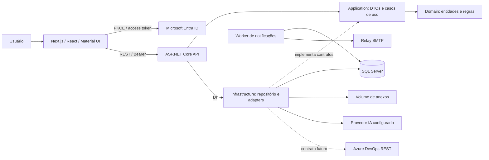
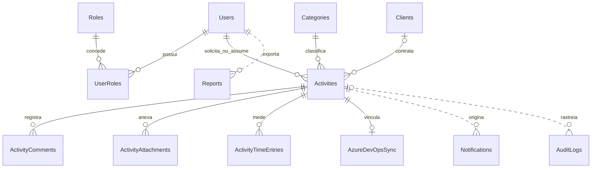

# Arquitetura



Dependências de código: Domain não depende de framework de persistência; Application depende de Domain; Infrastructure depende de Application; API é o ponto de composição. Consultas de dashboard/relatórios agregam dados no adapter de apresentação; extraí-las para handlers dedicados é o próximo passo quando o volume exigir SQL agregado/CQRS.

```text
SecOpsManager/
├── backend/
│   ├── SecOpsManager.sln
│   ├── src/
│   │   ├── SecOps.Domain/            entidades, status, regras de SLA
│   │   ├── SecOps.Application/       contratos, DTOs, ActivityService
│   │   ├── SecOps.Infrastructure/    EF Core, migrations, IA, SMTP, relatórios
│   │   └── SecOps.Api/               controllers, JWT, DI, erros, limites
│   ├── tests/SecOps.Tests/           regras, autorização e integração SQL
│   └── Dockerfile
├── frontend/
│   ├── src/app/                     entrada Next.js e CSS
│   ├── src/components/              workspace, gráficos, Kanban, editor, detalhes
│   ├── src/lib/                     contratos TS, MSAL/API e exemplos
│   ├── tests/                       testes Playwright
│   └── Dockerfile
├── docs/
├── scripts/
├── compose.yaml
└── .env.example
```

## Modelo de dados



Linhas pontilhadas representam referências lógicas preservadas na auditoria/outbox, sem exclusão em cascata. `ActivityComments`, `ActivityAttachments`, `ActivityTimeEntries`, `AuditLogs` e `Reports` registram `UserId` para autoria.

Identificadores GUID são atribuídos pelo domínio. Atividades e apontamentos usam `rowversion`; alterações de atividade exigem versão Base64. Atualização obsoleta retorna HTTP 409. Um índice filtrado garante no máximo um apontamento aberto para cada atividade/usuário. A alteração de tempo também atualiza a atividade, evitando que a conclusão concorra silenciosamente com a abertura de um cronômetro.

`AzureDevOpsSync`: ActivityId, Project, WorkItemType, WorkItemId, Url, SyncDate. `IAzureDevOpsService` contém Create, Update, SyncStatus e Import. O adapter atual informa explicitamente que a integração está desabilitada; não faz chamadas remotas.

`Notification`: Recipient, Kind, Subject, Text, DeduplicationKey, CreatedAt, SentAt, Attempts, Error. A gravação do outbox e a atividade compartilham o mesmo DbContext/SaveChanges. Envio SMTP ocorre depois do commit, fora da requisição.

`AuditLog`: UserId, ActivityId opcional, Action, Details JSON, CreatedAt. Edit registra antes/depois; Create, Delete, Status, Approve, Timer, Comment, Attachment, Report.Export, Login/Logout e AI.Suggestion registram ações. Login/logout são eventos explícitos do cliente; fechar o navegador não equivale a logout confirmado.

## Evolução

Contratos permitem substituir providers sem mudar o domínio. Para crescimento: agregação SQL no dashboard, busca paginada de catálogos, worker com lease/outbox distribuído, object storage com antivírus, políticas por equipe/cliente e adapter Azure DevOps. A autorização atual é por papel em todo o workspace; não há isolamento por cliente/tenant de negócio.
